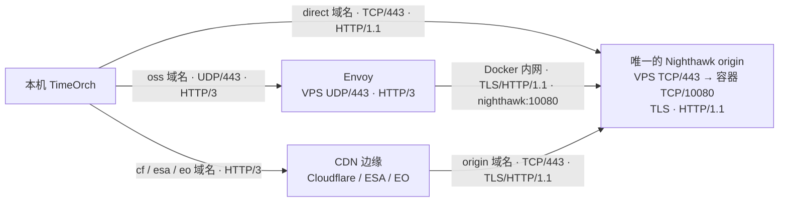

### 网络拓扑设计



### 域名和证书

| 域名 | DNS 记录 | 流量路径 | 边缘证书 / VPS 证书 |
| --- | --- | --- | --- |
| `direct.` | A → VPS · DNS only | client → VPS `TCP/443` · H1 | — / ACME `direct` |
| `oss.` | A → VPS · DNS only | client → Envoy `UDP/443` · H3 → 内网 `TCP/10080` · H1 | — / ACME `oss` + `origin` |
| `cf.`  | A → VPS · 橙云 | client → Cloudflare · H3 → VPS `TCP/443` · H1 | Cloudflare / ACME `cf` |
| `esa.` | CNAME → ESA · DNS only | client → ESA · H3 → `origin` `TCP/443` · H1 | ESA / ACME `origin` |
| `eo.` | CNAME → EO · DNS only | client → EO · H3 → `origin` `TCP/443` · H1 | EO / ACME `origin` |
| `origin.` | A → VPS · DNS only | CDN · H3 → VPS `TCP/443` · H1 | — / ACME `origin` |


### 项目架构

```text
.
├── AGENT.md
├── backend    # 统一的后端行为监测的 server
│   ├── compose.yaml
│   └── nighthawk.yaml
├── client
│   └── timeorch-x    # self fork version of timeorch
├── edge
│   ├── cdn    # 接入不同 cdn
│   │   ├── aliyun-esa
│   │   ├── cloudflare
│   │   └── edgeone
│   └── oss    # 接入不同的 oss proxy
│       ├── envoy
│       ├── haproxy
│       └── nginx
├── README.md
└── results
```


### 目的和说明

- 研究 blackhat chaos by design 的议题 / timeorch 的复现，只关注最核心的 ssro（temporal hijacking 不管）
- 测量不同的 oss proxy / cdn 对于 ssro 的表现，区别
- 通过 results 来分析 ssro 的效果，使用 ssro 的方式 和 不使用 ssro 的方式的区别


### 统计和分析

- 打算使用 fortio 来进行可视化的分析（nighthawk 导出到 fortio），观测 ssro 的几个指标，能够比较直观地看到 是否是请求在 proxy 层面被累积然后一次性释放
- race 的结果稳定性，使用 ssro 和不使用 ssro 的区别